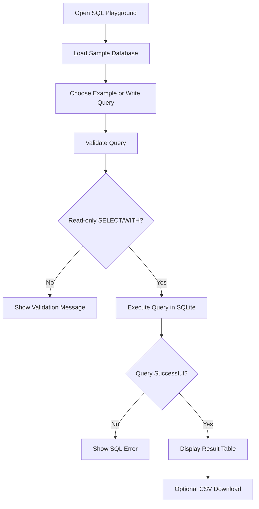
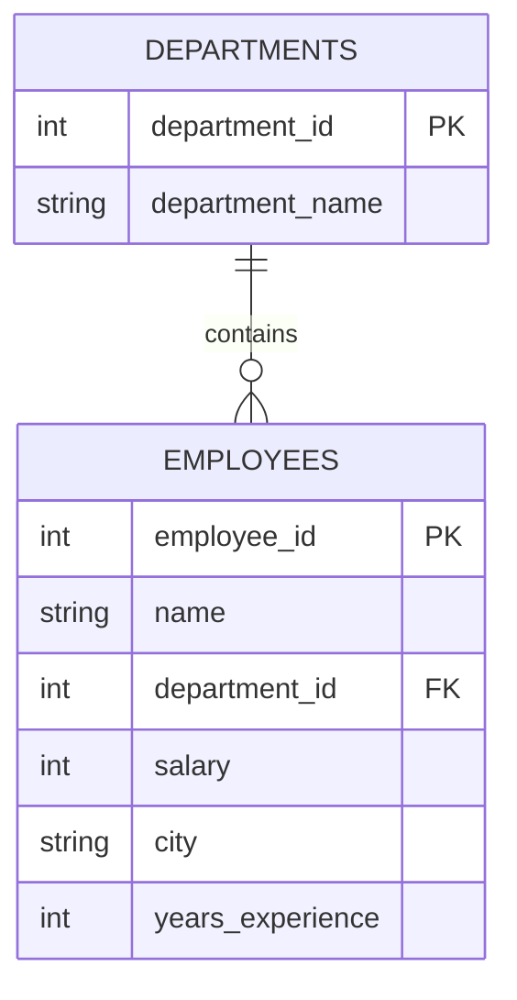
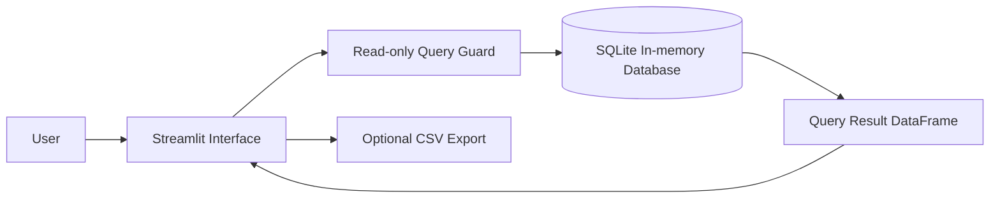

# 🧠 SQL Practice Playground

<p align="center">
  <strong>Practice SQL using a sample employee and department database.</strong>
</p>

<p align="center">
  
  
  
  
</p>

## 📌 Overview
A local SQL learning sandbox with sample tables, example queries, a read-only query editor, and downloadable results. It is designed for learning common interview topics such as filtering, joins, aggregation, and sorting.

## 🧭 Query Execution Flowchart


## 🗃️ Database ER Diagram


## 🏗️ Architecture


## 🧰 Technology Stack
| Layer | Technology | Purpose |
|---|---|---|
| UI | Streamlit | SQL editor and results |
| Language | Python | App and validation logic |
| Database | SQLite | Sample relational data |
| Data display | Pandas | Render query output |
| Export | CSV | Download results |

## ✨ Features
- Sample `employees` and `departments` tables.
- Example queries for `WHERE`, `JOIN`, `GROUP BY`, `HAVING`, and `ORDER BY`.
- Single read-only `SELECT`/`WITH` query guard.
- Display results and download them as CSV.
- In-memory database resets when the app process restarts.

## 📂 Project Structure
```text
03-sql-practice-playground/
├── app.py
├── requirements.txt
├── README.md
└── .gitignore
```

## 🚀 Getting Started
```bash
python -m venv .venv
# Windows: .venv\Scripts\activate
# macOS/Linux:
source .venv/bin/activate
pip install -r requirements.txt
streamlit run app.py
```

## 🧪 Example Queries
```sql
SELECT name, salary
FROM employees
WHERE city = 'Chennai'
ORDER BY salary DESC;
```

```sql
SELECT d.department_name, AVG(e.salary) AS avg_salary
FROM employees e
JOIN departments d ON e.department_id = d.department_id
GROUP BY d.department_name
HAVING AVG(e.salary) > 65000;
```

## ⚠️ Limitations
This is a local learning sandbox, not a secure public SQL execution service. Do not expose arbitrary SQL execution to untrusted users.

## 🔮 Future Improvements
- Add practice questions and expected outputs.
- Add query history and difficulty levels.
- Add window-function exercises and automated result checking.
